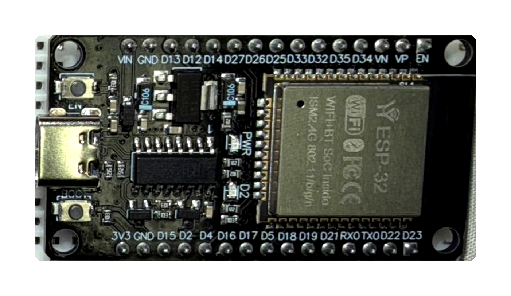
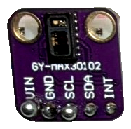
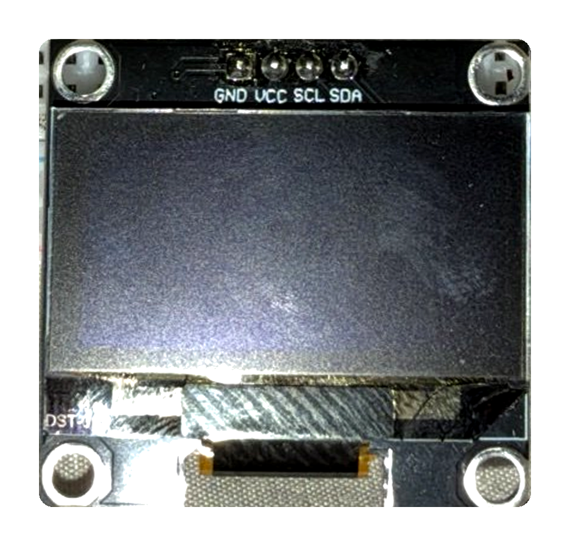

ESP32 Pulse Oximeter (MAX30102 + OLED)

A low-cost heart rate (BPM) and blood oxygen (SpO2) monitor built with an ESP32, a MAX30102 optical sensor and a 1.3" SH1106 OLED. Everything sits on a solderless breadboard and is joined with 10 jumper wires.

Finished device

⚠️ Educational project. This is not a medical device. Do not use the readings to make health decisions.

Features
Real-time heart rate (BPM) and SpO2 (%) on a 128×64 OLED
Finger detection with a 1-second grace period, so small finger movements do not reset the reading
Noise filtering: BPM accepted only within 40–220, SpO2 only within 70–100 %
5-beat moving average for a stable BPM value
SpO2 refreshed every second using a sliding window
Debug output on the Serial Monitor (IR level, BPM, average BPM, SpO2)
Runs offline, with no Wi-Fi and no cloud service
Hardware
Part	Qty	Notes
ESP32 DevKit, 30-pin (USB-C, CP2102)	1	Board: ESP32 Dev Module
GY-MAX30102 pulse-oximeter module	1	Red + IR LEDs, photodetector, I2C address 0x57
1.3" OLED 128×64, SH1106	1	I2C address 0x3C (not SSD1306)
Breadboard, 830 points	1	
Male-to-male jumper wires	10	Any colour
USB-C data cable	1	Must support data, not charge only

    

Wiring

All three parts share one I2C bus (SDA = GPIO21, SCL = GPIO22) and are powered from the ESP32's 3.3 V through the breadboard's top power rails.

#	From	To
1	ESP32 GND	Rail −
2	ESP32 3V3	Rail +
3	Rail −	OLED GND
4	Rail +	OLED VCC
5	ESP32 D22	OLED SCL
6	ESP32 D21	OLED SDA
7	Rail −	MAX30102 GND
8	MAX30102 VIN	Rail +
9	MAX30102 SCL	Same column as OLED SCL
10	MAX30102 SDA	Same column as OLED SDA

MAX30102 INT is not used.

Wiring diagram

Tips

Unplug USB while wiring.
Many 830-point breadboards have a break in the power rails at the middle. Keep all power wires on the ESP32 side, or bridge the two halves with short jumpers.
Check the OLED pin labels before wiring. Some modules swap GND and VCC.
Software Setup
Install the Arduino IDE (2.x recommended).
Boards Manager: install esp32 by Espressif Systems, then select ESP32 Dev Module.
Library Manager: install
SparkFun MAX3010x Pulse and Proximity Sensor Library
Adafruit SH110X (click Install All to add Adafruit GFX and Adafruit BusIO)
Open ESP32_PulseOximeter/ESP32_PulseOximeter.ino.
Select the board's COM port, then click Upload and wait for Done uploading.
Place a fingertip gently on the sensor and keep still for about 10 seconds.

Open the Serial Monitor at 115200 baud to see debug output.

How It Works
Program flow
setup()
 ├─ Serial 115200, I2C on GPIO21/22 @ 400 kHz
 ├─ OLED begin (0x3C)          → "STARTING / WAIT..."
 ├─ MAX30102 begin             → "SENSOR ERROR" and halt if not found
 ├─ sensor.setup(60, 1, 2, 100, 411, 4096), LED current 0x24
 ├─ testSampleRate()           → prints actual samples/sec
 └─ "PLACE FINGER"

loop()
 ├─ sensor.check(), then for each new sample:
 │    ├─ read IR + Red
 │    ├─ IR < 50,000 ?  → no finger (reset after > 1 s), skip sample
 │    ├─ calculateBPM(IR)
 │    └─ addSpO2Sample(IR, Red)
 └─ every 500 ms: updateOLED() + Serial log
Main objects
Object	Role
Wire	I2C bus shared by the OLED and the sensor (begin(21, 22), setClock(400000))
display	Adafruit_SH1106G(128, 64, &Wire, -1), the OLED driver
sensor	MAX30105 from the SparkFun library, which also supports the MAX30102

sensor.setup(60, 1, 2, 100, 411, 4096) means: LED brightness 60 · sample average 1 · LED mode 2 (Red + IR) · 100 samples/s · pulse width 411 µs · ADC range 4096. The LED current is then set to 0x24 (about 7 mA) for Red and IR, and the green LED is turned off.

Heart rate (BPM)
checkForBeat() (from heartRate.h) detects a peak in the IR signal, which marks one heartbeat.
Measure the time since the previous beat: BPM = 60000 / delta_ms (for example, 800 ms gives 75 BPM).
Keep only values within 40–220 BPM.
Store them in a 5-slot circular buffer and display the average.
Blood oxygen (SpO2)
Decimate 100 Hz to 25 Hz by keeping 1 of every 4 samples, which is the rate the Maxim algorithm expects.
Fill buffers of 100 IR + 100 Red samples, which is 4 seconds of data.
Call maxim_heart_rate_and_oxygen_saturation() (from spo2_algorithm.h). It compares the pulsatile (AC) and baseline (DC) parts of the Red and IR signals and returns SpO2 with a validity flag.
Show the value only if it is valid and within 70–100 %. Otherwise the display shows --.
Sliding window: keep the last 75 samples and add 25 new ones, so SpO2 updates about once per second.
Display states
State	OLED
Booting	PULSE OXIMETER / STARTING / WAIT...
Sensor missing	SENSOR ERROR / MAX30102 / NOT FOUND
No finger	PULSE OXIMETER / PLACE / FINGER
Measuring	PULSE OXIMETER / BPM:75 / O2:98%
Serial output (example)
FINGER DETECTED
BEAT DETECTED
RAW_SPO2=98 VALID_SPO2=1 ALGORITHM_BPM=76
IR=112345 BPM=74.63 AVG_BPM=75.10 SPO2=98
Configuration
Constant	Default	Meaning
SDA_PIN / SCL_PIN	21 / 22	I2C pins
OLED_ADDR	0x3C	OLED I2C address
FINGER_THRESHOLD	50000	IR level that counts as "finger present"
RATE_SIZE	5	Number of beats averaged
SAMPLE_COUNT	100	SpO2 buffer length (25 Hz → 4 s)
DECIMATION	4	100 Hz → 25 Hz
LED amplitude	0x24	Red/IR LED current (about 7 mA)
Troubleshooting
Problem	Fix
No COM port appears	Install the CP210x USB-to-UART driver (Silicon Labs) and use a data-capable cable
Adafruit_GFX.h: No such file or directory	Install Adafruit GFX (via Adafruit SH110X → Install All). If it still fails, move the sketchbook to a short path with English characters only (for example C:\Arduino), outside OneDrive
Sensor works but the OLED stays blank	Check the power-rail break on the breadboard and the OLED GND/VCC order. Make sure it is an SH1106 display
SENSOR ERROR on screen	Check the MAX30102 VIN/GND and the SDA/SCL wires
Unsure whether the board sees both devices	Run an I2C scanner. You should see 0x3C (OLED) and 0x57 (MAX30102)
BPM jumps around	Rest the finger lightly and keep still. Pressing too hard or moving adds noise
Limitations
The IR finger threshold (50,000) depends on skin, ambient light and pressure, so you may need to tune it.
SpO2 needs about 4 seconds of stable data before the first reading.
With no light shield, ambient light can disturb the readings more than on a clip-on oximeter.
Educational use only. Not calibrated or certified for medical use.
Repository Structure
.
├── ESP32_PulseOximeter/
│   └── ESP32_PulseOximeter.ino
├── images/
│   ├── finished.jpg
│   ├── esp32.png
│   ├── max30102.png
│   ├── oled.png
│   └── wiring.png
└── README.md
Acknowledgements
SparkFun MAX3010x Sensor Library, including heartRate.h and the Maxim spo2_algorithm.h
Adafruit SH110X and Adafruit GFX
License

Add a license of your choice (for example, MIT).
